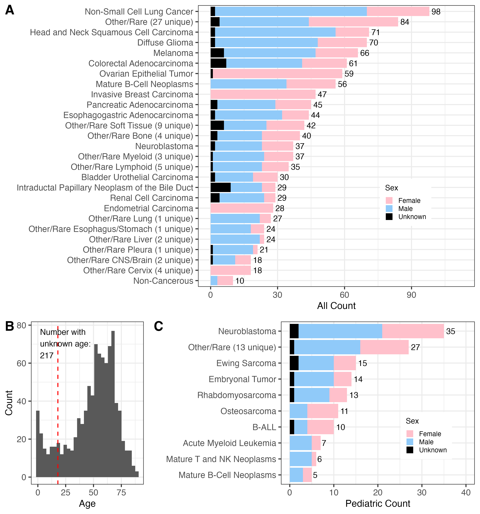
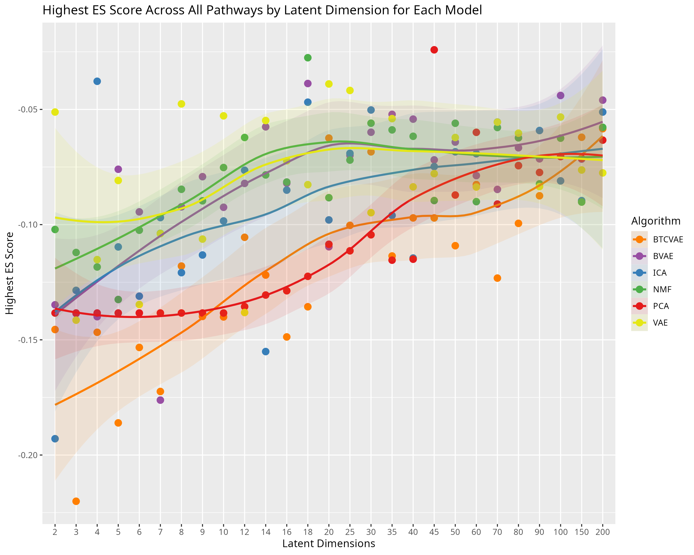
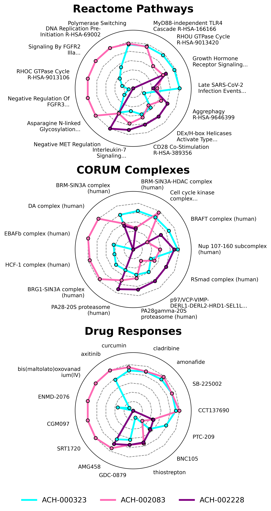
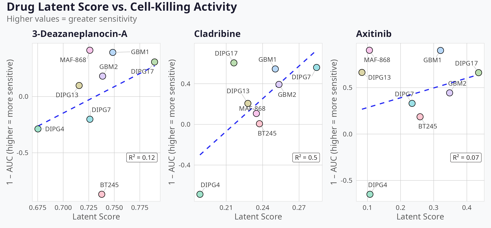

# Gene Dependency Representations


## Contents

- [Goal](#goal)
- [Data](#data)
- [Repository structure](#repository-structure)
- [How each module is organized](#how-each-module-is-organized)
- [Shared utilities and tests](#shared-utilities-and-tests)
- [Status](#status)
- [A visual tour](#a-visual-tour)
- [Environment setup](#environment-setup)

## Goal

Current cancer treatments tend to be toxic and leave patients with lifelong side effects.
The future of drug development is based on synthetic lethality, where the combination of two genetic events results in cell death.
The first molecular targeted therapeutic exploiting a synthetic lethal exposed by an inactivated tumor suppressor gene (BRCA1/2) received FDA approval in 2016, a PARP inhibitor.
Synthetic lethality-based treatments work against a majority of cancer mutations, are easier to match to responding patients, and are less toxic than traditional chemotherapy.

**The goal of this project is to discover multivariate gene vulnerability patterns in cancer.**
We use cancer cell line data from DepMap to find multivariate gene vulnerability patterns that can inform the development of novel cancer treatments.
We apply an ensemble of dimensionality reduction methods — PCA, ICA, NMF, and several VAE variants — to gene knockout data to discover multivariate gene vulnerabilities across many latent resolutions.
This ensemble approach is known as BioBombe.
We interpret the resulting latent dimensions against curated gene sets (CORUM, Reactome) and drug screen data, compare representations between pediatric and adult cancers, and test whether they transfer to data with no matched CRISPR screen — RNA-seq-only collaborator samples, and new gene-dependency screens run through the same ensemble directly.

## Data

All DepMap and PRISM data are publicly available.
- Cancer dependency data: [Cancer Dependency Map resource](https://depmap.org/portal/download/) (pinned to the 24Q2 release — see [0.data-download](0.data-download/)).
- Drug response data: the [PRISM Repurposing screen](https://depmap.org/repurposing/), also hosted on DepMap.
- The pretrained, 486-model BioBombe ensemble is hosted on [Figshare](https://figshare.com/articles/dataset/Gene_Process_Dependencies_-_BioBombe_Models/33437659) rather than checked into version control (~1.2 GB) — see [0.data-download/3.download-saved-biobombe-models-from-figshare.ipynb](0.data-download/3.download-saved-biobombe-models-from-figshare.ipynb).
- RNA-seq data without a matched CRISPR screen comes from two sources: DepMap's own RNA-seq profiles ([5.RNAseq](5.RNAseq/)), and bulk RNA-seq from pediatric tumors shared by a project collaborator, Dr. Adam Green, via [NCBI GEO](https://www.ncbi.nlm.nih.gov/geo/query/acc.cgi?acc=GSE231858) ([6.collab-data](6.collab-data/)).
- [8.apply-biobombe-new-data](8.apply-biobombe-new-data/) applies the trained ensemble to new, externally-generated gene-dependency screens (CRISPR knockout data shaped like DepMap's, but not part of it) — the Largaespada lab's MPNST screen is the worked example currently configured there.

## Repository structure

This repository is a numbered pipeline, meant to be run in order.

| Order | Module | Description |
| :---- | :----- | :---------- |
| [0.data-download](0.data-download/) | Download data | Download CRISPR gene effect data, cell line metadata, a QC'd gene dictionary, and the pretrained BioBombe ensemble |
| [1.data-exploration](1.data-exploration/) | Explore and split data | Visualize cell line demographics and split gene effect data into train, test, and validation sets |
| [2.prototype-VAE-models](2.prototype-VAE-models/) | Train and validate a single Beta-VAE / Beta-TC-VAE | Optimize hyperparameters, train one representative Beta-VAE and Beta-TC-VAE alongside PCA/ICA/NMF baselines, then check every model with heatmaps, GSEA, and t-tests |
| [3.run-biobombe](3.run-biobombe/) | Train and validate the full BioBombe ensemble | Sweep PCA, ICA, NMF, VanillaVAE, BetaVAE, and BetaTCVAE across many latent dimensions, run GSEA against CORUM and Reactome on each, then check ensemble consistency with CKA and reconstruction quality |
| [4.drug-dependency](4.drug-dependency/) | Correlate with drug response | Correlate latent dimensions with PRISM drug screen viability data, then visualize the strongest per-sample hits with spider and pinwheel plots |
| [5.RNAseq](5.RNAseq/) | Bridge to RNA-seq | Train models that predict each latent dimension from RNA-seq expression, for samples without a CRISPR screen |
| [6.collab-data](6.collab-data/) | Apply to external data | Apply the RNA-seq bridge to real collaborator samples and compare predicted vulnerabilities to observed cell killing |
| [7.shiny-app](7.shiny-app/) | Prepare visualization data | Build the PCA projections used by the project's Shiny app |
| [8.apply-biobombe-new-data](8.apply-biobombe-new-data/) | Apply BioBombe to new data | Align a new gene-dependency dataset to the trained ensemble's genes, sanity-check its distribution against DepMap, apply every saved model, annotate the resulting latent scores with CORUM/Reactome pathways and drug correlations, and test for differences by sample group |

## How each module is organized

Each numbered module follows the same convention:

- **Notebooks at the module root** (`N.description.ipynb`) are the primary, interactively-runnable entry points — start here.
- **`nbconverted/`** holds each notebook's paired script (`.py` or `.r`, via `jupyter nbconvert --to script`), kept in sync with its notebook and runnable headlessly, e.g. without Jupyter.
- **A handful of steps are too compute-heavy to keep as an executed, paired notebook** (full-ensemble training, full-ensemble GSEA, full-ensemble pinwheel plotting across every sample). These live as plain scripts directly at the module root instead — e.g. [3.run-biobombe/1.train_biobombe_ensemble.py](3.run-biobombe/1.train_biobombe_ensemble.py) — meant to be run directly (often in the background, over many hours), not through Jupyter.
- **`scripts/`**, where it still exists, holds genuine shared helper code with no notebook of its own (e.g. `3.run-biobombe/scripts/model_io_utils.py`).
- **`utils/`** (module-local, or the shared one at the repository root) holds the tested functions every numbered step in that scope builds on.

Every script and notebook expects to be run with its own module directory as the working directory, unless its header says otherwise.

## Shared utilities and tests

The repository-root [utils/](utils/) holds infrastructure shared across modules 3, 4, 6, and 8: pathway/drug-to-latent-dimension assignment (`latent_annotation.py`), the pinwheel plot itself (`pinwheels.py`), and generic model/data loading helpers (`model_utils.py`, `data_loader.py`).
It — and [8.apply-biobombe-new-data/utils/](8.apply-biobombe-new-data/utils/), which adds the moderated-t differential testing used there — each keep a plain-assert test suite under their own `tests/` directory (no pytest dependency required). Run any of them directly:

```sh
python utils/tests/test_latent_annotation.py
python 8.apply-biobombe-new-data/utils/tests/test_stats.py
```

## Status

The full BioBombe ensemble, `saved_models/` under [3.run-biobombe](3.run-biobombe/), is downloaded rather than trained locally — fetch it with [0.data-download/3.download-saved-biobombe-models-from-figshare.ipynb](0.data-download/3.download-saved-biobombe-models-from-figshare.ipynb).
A single trained Beta-VAE checkpoint is also available at [2.prototype-VAE-models/results/best_vae_model.pth](2.prototype-VAE-models/results/best_vae_model.pth).
[8.apply-biobombe-new-data](8.apply-biobombe-new-data/) is the actively developed module: its pipeline is dataset-agnostic (any CRISPR-knockout-shaped dataset can be run through it — see its own README), and is currently being exercised on an external MPNST gene-dependency screen as a worked example.

## A visual tour

**Cell line cohort.** DepMap cell lines span many cancer types, ages, and pediatric or adult status.



**Learned latent space.** The trained Beta-VAE embeds cell lines using their gene knockout dependency scores.


**Ensemble consistency.** Each point is one model's single strongest pathway enrichment at that latent dimensionality; across the full 2–200 dimension sweep, every algorithm in the ensemble (PCA, ICA, NMF, and three VAE variants) converges toward comparably strong best-pathway hits as dimensionality grows.



**Per-sample interpretation.** Each sample's strongest latent dimensions are annotated with their matching Reactome pathways, CORUM complexes, and correlated drugs — a pinwheel/radar view of what distinguishes one sample's learned representation from another's.



**Bridging to samples with no CRISPR screen.** Vulnerabilities predicted from RNA-seq alone, via the bridge trained in [5.RNAseq](5.RNAseq/), correlate with cell killing actually observed in real collaborator samples.



## Environment setup

This project uses two separate conda environments: `gene_dependency_representations`, for the Python/PyTorch analysis pipeline (every numbered module), and `gene_dependency_figures`, for the R-based figure scripts under a few modules' `nbconverted/` directories. Most contributors only need the first.

### Step 1: Install mamba

These environments install PyTorch and JupyterLab, so they're large enough that conda's solver is slow.
[mamba](https://mamba.readthedocs.io/) is a drop-in, much faster replacement.

```sh
conda install -n base -c conda-forge mamba -y
```

### Step 2: Create the environment(s)

```sh
# conda version 24.5.0
mamba env create --yes --file environment.yml           # main pipeline (required)
mamba env create --yes --file figure_environment.yml    # R figure scripts only (optional)
```

Plain `conda env create` also works for either, if you'd rather skip mamba, just slower to resolve.

### Step 3: Activate an environment

```sh
conda activate gene_dependency_representations   # for everything except the R figure scripts
conda activate gene_dependency_figures            # for the .r scripts specifically
```
